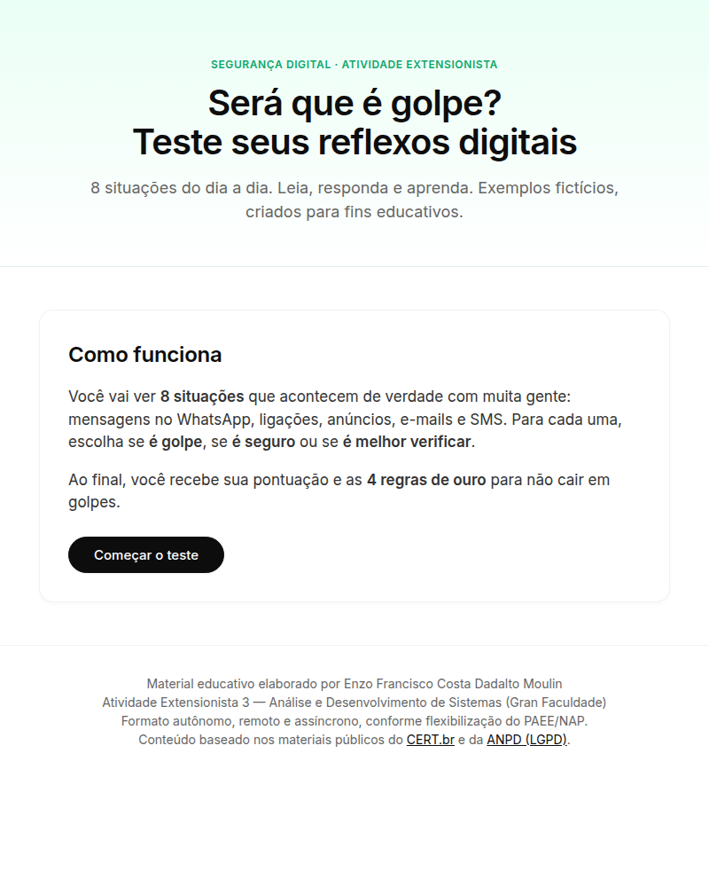

# Será que é golpe? — Teste seus reflexos digitais

[](https://enzomoulin.github.io/sera-golpe/)
[](#)
[](#)

Quiz educativo interativo com **8 situações fictícias** do dia a dia sobre golpes
digitais (WhatsApp clonado, falso banco, PIX com pressa, parente pedindo dinheiro,
SMS dos Correios, e-mail bancário, falsa vaga de emprego, oferta por e-mail),
cada uma com resposta e explicação educativa.

🌐 **Demo:** https://enzomoulin.github.io/sera-golpe/

## Demonstração


## Recursos
- Tela de início com explicação do teste
- Barra de progresso + contador "Pergunta X de 8"
- Feedback imediato por situação (correto/atenção + explicação)
- Pontuação final com as 4 regras de ouro
- Melhor pontuação salva no aparelho (localStorage)
- Botões de refazer e compartilhar
- Layout responsivo (mobile-first) e navegação por teclado

## Tecnologias
HTML5 + CSS3 + JavaScript vanilla, sem dependências e sem build.
Design inspirado em sistemas de documentação modernos (Inter, cards com borda
sutil, pills, foco em legibilidade).

## Como rodar localmente
```bash
# qualquer servidor estático, ex.:
python3 -m http.server 8000
# abrir http://localhost:8000
```
Ou abra `index.html` direto no navegador.

## Estrutura
```
├── index.html   # estrutura + metadados (SEO/OG) + acessibilidade
├── styles.css   # design system (tokens, componentes, responsivo)
├── app.js       # dados do quiz + lógica de pontuação/progresso
├── demo.png     # captura da tela inicial
└── README.md
```

## Contexto acadêmico
Atividade Extensionista 3 — Análise e Desenvolvimento de Sistemas
(Gran Faculdade). Ação autônoma, remota e assíncrona, conforme flexibilização
do PAEE/NAP. Conteúdo baseado nos materiais públicos do CERT.br e da ANPD
(LGPD). Exemplos fictícios, elaborados para fins didáticos.
